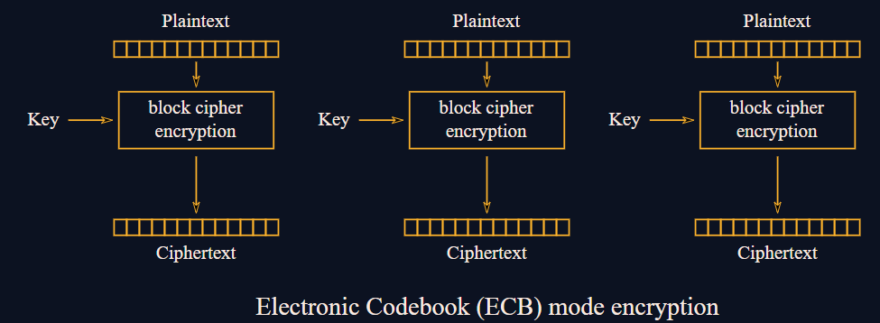
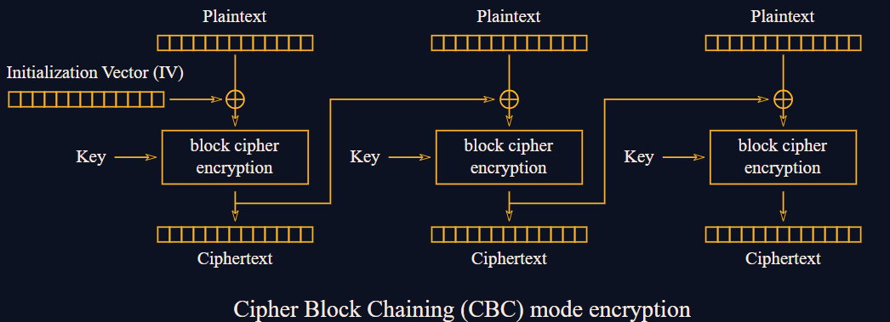
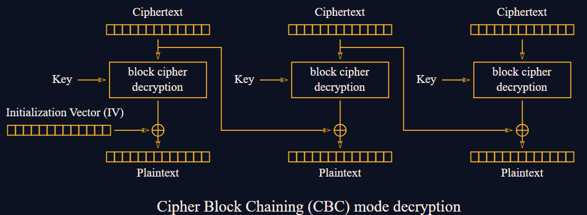
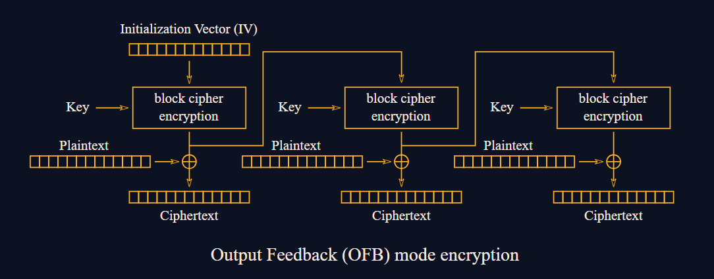

# AES  
AES is a symmetric block cipher, which means that it uses the same key to encrypt and decrypt. It encrypts exactly 16 bytes (128 bits) at a time, this is the same for all key sizes.  

AES-128 --> 10 Rounds  
AES-192 --> 12 Rounds  
AES-256 --> 14 Rounds  

### Initial States  
A block is represented as a 4 by 4 matrix:  

$$ 
\begin{bmatrix} 
\text{b0} \ \text{b4} \ \text{b8} \ \text{b12} \\
\text{b1} \ \text{b5} \ \text{b9} \ \text{b13} \\
\text{b2} \ \text{b6} \ \text{b10} \ \text{b14} \\
\text{b3} \ \text{b7} \ \text{b11} \ \text{b15} \\
\end{bmatrix}
$$  

Each byte is represented as an element in $$\text{GF}(2^8)$$ or as a polynomial with a degree less than 8 with binary coefficients.  
For example: $$0x57 = 01010111 = x^6 + x^4 + x^2 + x + 1$$  

#### Operations  
All operations are done under modulo $$x^8 + x^4 + x^3 + x + 1$$ or 0x11B which is an irreducible polynomial. Addition in $$\text{GF}(2^8)$$ is XOR operation. Multiplication in $$\text{GF}(2^8)$$ is polynomial multiplication.

### Key Schedule  
The Key Expansion Algorithm takes in 16 byte key (For AES-128) and expands it into 11 16 byte keys, total of 176 bytes.  
The initial input key is also known as the Master Key which is the given unexpanded key.  

Key Expansion Algorithm:  
$$\text{Key 1} = \text{Key Expansion}(\text{Master Key})$$  
$$\text{Key 2} = \text{Key Expansion}(\text{Key 1})$$  
$$\dots$$  
$$\text{Key 11} = \text{Key Expansion}(\text{Key 10})$$  

$$\text{Input Key} \rightarrow \text{S-Box}(\text{rotl}(\text{Input Key})) \oplus \text{RConst}[i] \rightarrow \text{Output Key}$$  
$$\text{RConst}$$ is an array of constant bytes, and $$i$$ is dependent on the Input Key's index.  

For the following examples:  
Master Key = $$\text{W}[0] || \text{W}[1] || \text{W}[2] || \text{W}[3]$$  
$$\text{W}[3] = \text{AF 7F 67 98}$$  

For $$W[i]$$ where $$i \equiv 0 \pmod{4}$$:  
$$\text{W}[i] = \text{W}[i - 4] \oplus \text{S-Box}(\text{rotl}(\text{W}[i - 1])) \oplus \text{RConst}[i \div 4]$$  
For $$\text{W}[i]$$ where $$i \not\equiv 0 \pmod{4}$$:  
$$\text{W}[i] = \text{W}[i - 4] \oplus \text{W}[i - 1]$$  

#### Rotate Left $$(\text{rotl})$$  
A left cyclic rotation of the initial key  
$$\text{rotl}(\text{Master Key}) = \text{7F 67 98 AF}$$  

#### RConst  
$$\text{RConst} = [\text{01, 02, 04, 08, 10, 20, 40, 80, 1B, 36}]$$  
$$\text{RConst}[i - 1]$$ is XORed with the $$1$$st bytes of the $i$th iteration of the algorithm.  

### SubBytes (S-Box)  
SubBytes takes an input byte and looks it up in the S-Box which is a precomputed look-up table and replace the input byte with its corresponding byte in the lookup table.  

#### S-Box  
S-Box is a look up table which stores the output of this following function:
$$\text{S}(\text{b}) \rightarrow \text{b}^{-1} \oplus \text{rotl1} \oplus \text{rotl2} \oplus \text{rotl3} \oplus \text{rotl4} \oplus \text{0x63}$$, where rotl stands for Rotate Left and rotates $$\text{b}^{-1}$$ by given number of bits. $$\text{b} \cdot \text{b}^{-1} \equiv \text{0x01} \pmod{\text{0x11B}}$$. Define $$0^{-1} \equiv 0 \pmod{\text{0x11B}}$$.  

### ShiftRows
Row r of the current state is rotated left by r bytes:  

$$
\begin{bmatrix} 
\text{s0} \ \text{s4} \ \text{s8} \ \text{s12} \\
\text{s1} \ \text{s5} \ \text{s9} \ \text{s13} \\
\text{s2} \ \text{s6} \ \text{s10} \ \text{s14} \\
\text{s3} \ \text{s7} \ \text{s11} \ \text{s15} \\
\end{bmatrix} 

\rightarrow

\begin{bmatrix} 
\text{s0} \ \text{s4} \ \text{s8} \ \text{s12} \\
\text{s5} \ \text{s9} \ \text{s13} \ \text{s1} \\
\text{s10} \ \text{s14} \ \text{s2} \ \text{s6} \\
\text{s15} \ \text{s3} \ \text{s7} \ \text{s11} \\
\end{bmatrix}
$$

### MixColumns
MixColumns are calculations done to every single column by assigning a new value to each byte in a column dependent on the initial value of every element in each column.  

$$a^{'}_0 = 2\text{a}_0 \oplus 3\text{a}_1 \oplus 1\text{a}_2 \oplus 1\text{a}_3 \newline$$  

$$a^{'}_1 = 1\text{a}_0 \oplus 2\text{a}_1 \oplus 3\text{a}_2 \oplus 1\text{a}_3 \newline$$  

$$a^{'}_2 = 1\text{a}_0 \oplus 1\text{a}_1 \oplus 2\text{a}_2 \oplus 3\text{a}_3 \newline$$  

$$a^{'}_3 = 3\text{a}_0 \oplus 1\text{a}_1 \oplus 1\text{a}_2 \oplus 2\text{a}_3 \newline$$  

### AddRoundKey  
We can obtain each Round's Key from the Key Schedule, then simply XOR the 16-byte state byte by byte with the current round's key, where the first round's key is the Master Key.  

### Full Encryption Algorithm  
1 Round: SubBytes -> ShiftRows -> MixColumns -> AddRoundKey  
Initial State of 16-bytes -> AddRoundKey -> 9 Rounds -> ShiftRows -> MixColumns -> AddRoundKey -> Output.  

***

## AES-ECB  
{: style="display: block; margin: 0 auto;"}  

AES-ECB works by padding the initial plaintext till block length, split it up into equal blocks and encrypts all of them using the same key. It then concatenates the resultant ciphertexts back together. This mode of AES does not use an IV or Nonce.  

### Vulnerabilties  
#### Bytes at a Time ECB Decryption  
Byte-at-a-time ECB Decryption is a form of vulnerability in AES-ECB encryption algorithms, it uses a Chosen Plaintext Attack (CPA) in order to directly obtain the plaintext.  

As AES-ECB encryption's nature make it such that every single block is independently encrypted, we can slowly extract the original plaintext if we are able to append our own custom plaintext in front of the original plaintext in order to cleverly recover the original plaintext.  

DEMO FLAG: FLAG{ghx312ghx312}  

As AES-ECB encrypts in 16 byte blocks, we can split up and see the original blocks that will initially be encrypted.  

Block 1: FLAG{ghx312ghx31  
Block 2: 2}  

We can use our ability to concatenate padding to the front of the plaintext before it encrypts in order to recover the original plaintext, one byte at a time.  

Block 1: AAAAAAAAAAAAAAAX  
Block 2: AAAAAAAAAAAAAAAF  
Block 3: LAG{ghx312ghx312  
Block 4: }aaaaaaaaaaaaaaa  

As we know the first 15 characters of the first 2 blocks, we can simply guess X until the first 2 blocks matches.  

Block 1: AAAAAAAAAAAAAAFX  
Block 2: AAAAAAAAAAAAAAFL  
Block 3: AG{ghx312ghx312}  

After guessing the first block of the flag, we can use the above method in order to compare the bytes between the first block and the third block in order to guess the bytes inside the second block of the flag.  

For example:  
$$\text{CT}_1 = \text{AES}(\text{admin=})$$  
$$\text{CT}_2 = \text{AES}(\text{True: Apples fall})$$  
What we can do is, assuming that both blocks are fully padded, we can concatenate the ciphertexts together in order to obtain 
$$\text{AES}^{-1}(\text{CT}_1 \vert\vert \text{CT}_2) \rightarrow \text{admin=True: Apples fall}$$. The machine will then parse $$\text{admin = True}$$ and elevate our status.  

***

## AES-CBC  
{: style="display: block; margin: 0 auto;"}  
{: style="display: block; margin: 0 auto;"}  

AES-CBC works by initially padding the intial plaintext to block length, splitting it up into blocks. It then chooses a nonce or IV which is a random string of 16 bytes that will only be used once. We then XOR the first block with this nonce before encrypting as per normal with our key. This resultant encrypted block is then XORed with the next block's plaintext before encrypting it as per normal.  

### Encryption  
Generally, encryption for the first block:  
$$\text{ENC0} = \text{AES}(\text{PT0} \oplus \text{IV})$$  

Encryption for each subsequent block:  
$$\text{ENCX} = \text{AES}(\text{PTX} \oplus \text{ENC(X - 1)})$$  

Note: Encryption is not parallelizable  

### Decryption  
Generally, decryption for first block:  
$$\text{PT0} = \text{AES}^{-1}(\text{ENC0}) \oplus \text{IV}$$  

Decryption for each subsequent block:  
$$\text{PTX} = \text{AES}^{-1}(\text{ENCX}) \oplus \text{ENC(X - 1)}$$  

Note: Decryption is parallelizable  

### Vulnerabilities  
#### CBC Cut and Paste Attack  
CBC Cut and Paste Attacks work by flipping bits of the previous ciphertext or the IV in order to edit the contents of the next decrypted block at the cost of mangling every other block. This requires knowledge of the plaintext as its aim is to edit the content of it without the use of a key.  

We can obtain every block's state before encryption through:  
1. First Blocks: $$\text{XOR PT}_1 = \text{IV} \oplus \text{PT}_1$$  
2. Other Blocks: $$\text{XOR PT}_x = \text{CIPHER}_{x - 1} \oplus \text{PT}_x$$  

Now we have the ciphertext after the AES decryption stage but before the XOR stage. As CBC Mode uses IV or previous Ciphertext Blocks for the XOR stage, we can control what CBC uses to XOR in order to decrypt. We can control this output by simply editing the corresponding IV or Ciphertext Block.

Example:  
Original Plaintext = False. We want to change this to "True;". The target text is in the first block, so we will be editing the IV in order to get the desired decrypted output of "True;".  

Original Plaintext: "46616C7365" --> False in Hex  
Target Plaintext: "547275653B" --> True in Hex  
We first find the XORED PT1 which is the XORED encrypted bytes of the first block, by taking $$\text{PT1} \oplus \text{IV}$$ at those bytes, since we want, $$\text{IV} \oplus \text{XORED PT}_1 = \text{Target Plaintext}$$,  
we can calculate, $$\text{NEW IV} = \text{Target Plaintext} \oplus \text{XORED PT}_1$$  
We then edit the IV correspondingly in order to receive the new desired decrypted plaintext.  

Note: This will jumble up all other blocks that are involved in the decryption process, so ensure that all the information that you need is in 1 block which you will edit.  

#### IV Misuse  
##### IV = Key  
When the IV = Key and is not revealed to us and we are able to use a Chosen Plaintext Attack, we can first encrypt 2 blocks with the same content.  
$$\text{XOR1} = \text{PT1} \oplus \text{IV}$$  
$$\text{XOR2} = \text{PT2} \oplus \text{CT1}$$   

When we send ciphertext to decrypt, instead of sending $$\text{CT1}\vert\vert\text{CT2}$$ we send $$\text{CT2}\vert\vert\text{CT2}$$, this decrypts the first block as $$\text{PT2} \oplus \text{CT1} = \text{XOR2}$$.  
$$\text{NPT1} = \text{IV} \oplus \text{XOR2}$$ --> $$\text{NPT1} = \text{IV} \oplus \text{PT2} \oplus \text{CT1}$$   
As $$\text{PT2}$$ and $$\text{CT1}$$ are known, $$\text{IV} = \text{NPT1} \oplus \text{CT1} \oplus \text{PT2}$$  

***

## AES-OFB  
{: style="display: block; margin: 0 auto;"}  

AES-OFB works by encrypting the IV, XORing it with the plaintext, and repeatedly encrypting the IV for each subsequent block.  

### Vulnerabilities  
#### Chosen Plaintext Attack  
Chosen Plaintext Attack for OFB relies on the vulnerability where the user is allowed to supply their own IVs. As in OFB, the plaintext does not go through the AES encryption algorithm, instead we encrypt the IV which is never revealed to us. In order to recover the encrypted IV, we simply need the original plaintext and its corresponding ciphertext given an IV.  

$$\text{ENC IV} = \text{AES}(\text{IV})$$  
$$\text{CT} = \text{PT} \oplus \text{ENC IV}$$  

If we are given the ability to encrypt a chosen plaintext with a chosen IV, we can choose a random plaintext as long as we know its initial content, and the IV that was used to encrypt the flag.  

We can then find the encrypted IV by performing: $$\text{ENC IV} = \text{ENC PT} \oplus \text{PT}$$.  
Using the known encrypted IV, we can recover the flag: $$\text{FLAG} = \text{CT} \oplus \text{ENC IV}$$  

***

## AES-CTR  
To be added